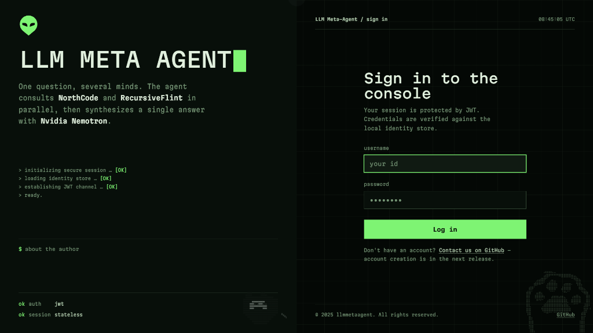
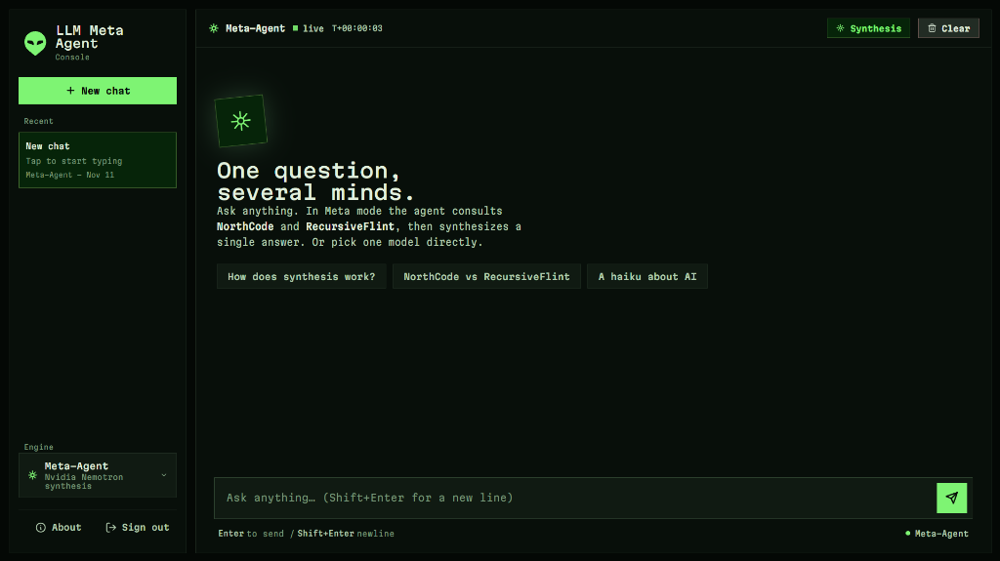
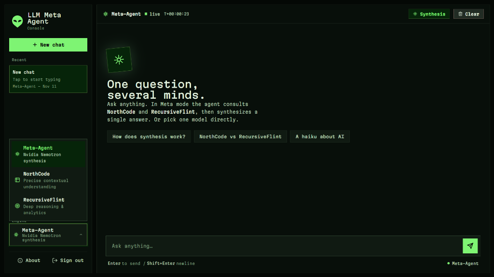
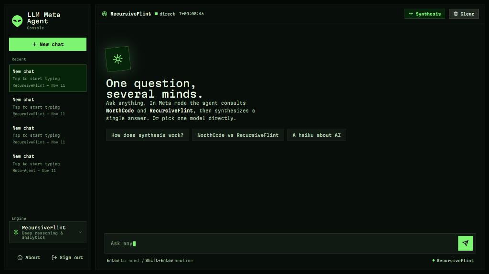
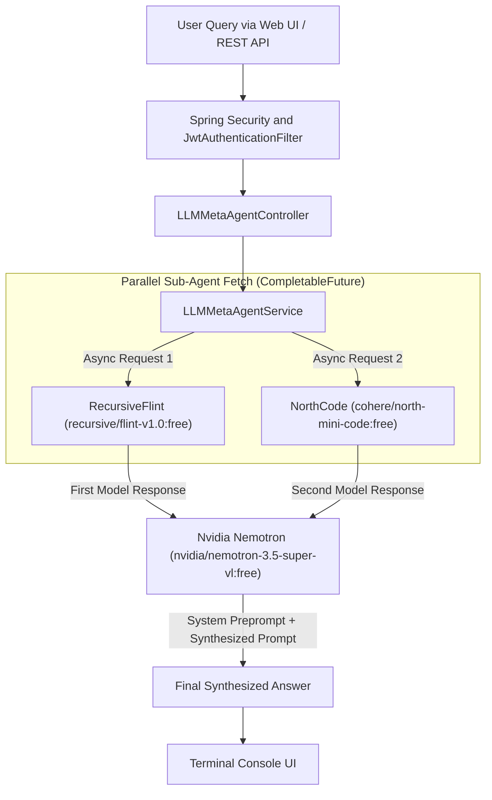

# 🧠 LLM Meta-Agent

An advanced multi-agent AI system built with **Spring Boot 3.5.9 (Java 21)** and **Spring AI 1.1.2**. It coordinates and queries two specialized underlying models (**RecursiveFlint / NexAGI** and **NorthCode**) concurrently, then synthesizes a superior, unified response using **Nvidia Nemotron** as the central synthesis engine.

Features a responsive, retro-futuristic **Terminal console UI** with JWT-backed stateless authentication, per-user conversational memory, and real-time model inspection.

    

---

## 📸 Screenshots

| Sign-in Console (Terminal Theme) | Meta-Agent Synthesis Console |
| :---: | :---: |
|  |  |

| Interactive Model Picker | Direct Model Inspection (RecursiveFlint) |
| :---: | :---: |
|  |  |

---

## ✨ Key Features

- **🔄 Multi-Model Parallel Synthesis**: Concurrently queries **RecursiveFlint** (`recursive/flint-v1.0:free`) and **NorthCode** (`cohere/north-mini-code:free`), then synthesizes a cohesive final response via **Nvidia Nemotron** (`nvidia/nemotron-3.5-super-vl:free`).
- **⚡ Asynchronous Execution**: Powered by `CompletableFuture` to fetch sub-model responses in parallel, dramatically cutting end-to-end response latency.
- **🔐 JWT Stateless Authentication**: Robust user authentication with JWT stored in secure `HttpOnly` cookies and managed by Spring Security filters.
- **🧠 Short-Term Chat Memory**: Per-user conversational context tracking using Spring AI `MessageWindowChatMemory` (supports contextual multi-turn conversation).
- **🖥️ Phosphor Terminal UI**: Lightweight single-page interface with Martian Mono typography, real-time typewriter and streaming animations, and zero external frontend build step.
- **📊 Real-time Model Insights**: Transparently inspect sub-model intermediate outputs via `/api/nvidia/firstmodelresponse` and `/api/nvidia/secondmodelresponse` or the UI synthesis drawer.
- **📝 Externalized Preprompt**: Synthesis prompt rules cleanly decoupled in `classpath:Preprompt` for rapid experimentation and prompt tuning.

---

## 🌐 Live Demo

Experience the application live: **[https://llm-meta-agent.onrender.com/](https://llm-meta-agent.onrender.com/)**  
*(Note: Initial spin-up may take ~60 seconds on free tier hosting).*

---

## 🏗️ System Architecture



### Architectural Highlights
1. **Parallel Execution**: Both sub-agent calls run concurrently with `CompletableFuture.supplyAsync()`.
2. **Context Window Memory**: NorthCode retains dialogue context across turns with `MessageWindowChatMemory` keyed by authenticated username.
3. **Synthesis Engine**: Nvidia Nemotron receives the original user request alongside both model outputs and synthesizes them based on instructions in `Preprompt`.

---

## 💡 Example Query & Synthesis Walkthrough

To see why synthesis produces a superior answer compared to querying a single model, consider this real-world example:

> **User Query:** *"Compare Apache Kafka vs RabbitMQ for an event-driven financial transaction pipeline."*

````carousel
```markdown
### 1️⃣ Sub-Model A: RecursiveFlint (Deep Analytical Reasoning)
Focuses on throughput, log-structured storage, and retention:
- Highlights Kafka's distributed commit log, sequential disk I/O, and partitioned consumer groups.
- Analyzes durability: replica sets, `acks=all`, and zero data loss on broker crashes.
- Identifies limitations: Partition rebalancing overhead and operational complexity for small message volumes.
```
<!-- slide -->
```markdown
### 2️⃣ Sub-Model B: NorthCode (Precise Implementation & Protocol Context)
Focuses on protocol mechanics, routing topologies, and code contracts:
- Emphasizes RabbitMQ's AMQP 0-9-1 flexibility: exchange bindings (topic, direct, headers), DLQs, and manual acks.
- Notes RabbitMQ memory consumption bottlenecks when millions of messages queue up.
- Highlights exact Java/Spring AMQP template vs Spring Kafka consumer listener configurations.
```
<!-- slide -->
```markdown
### 3️⃣ Meta-Agent: Nvidia Nemotron (Final Synthesized Output)
Merges analytical depth with implementation precision, eliminating duplication:
- **Decision Matrix**: Structured trade-off comparison (Throughput vs Flexible Routing).
- **Architecture Recommendation**: Recommends Kafka for immutable transaction audit trails and event replay, and RabbitMQ for discrete payment routing/commands requiring complex routing keys.
- **Unified Summary**: A clean, balanced answer without robotic "Model 1 said / Model 2 said" preamble.
```
````

---

## 📂 Project Structure

```text
LLM-Meta-Agent/
├── .github/                         # Repository templates & CI configuration
├── docs/assets/screenshots/         # Terminal console UI screenshots & assets
├── src/
│   ├── main/
│   │   ├── java/com/llm/LLM/Meta_Agent/
│   │   │   ├── Configuration/       # Beans, OpenAiChatModel qualifiers, ChatMemory, Security
│   │   │   ├── Controller/          # REST endpoints (/api/nvidia, /api/recursiveflint, etc.)
│   │   │   ├── Service/             # Multi-agent async orchestrator & JWT generator
│   │   │   └── LlmMetaAgentApplication.java
│   │   └── resources/
│   │       ├── static/              # Terminal Console & Auth UI (index.html, login.html)
│   │       ├── Preprompt            # Externalized synthesis prompt rules & constraints
│   │       └── application.properties
│   └── test/                        # Context load unit test suite
├── Dockerfile                       # Multi-stage container build definition
├── pom.xml                          # Maven dependencies (Spring AI 1.1.2, JJWT, etc.)
└── README.md                        # Project documentation
```

---

## 🛠️ Technology Stack

| Category | Technologies |
| :--- | :--- |
| **Backend & Core** | `Java 21` • `Spring Boot 3.5.9` • `Spring AI 1.1.2` • `Maven` |
| **Security & Auth** | `Spring Security 6` • `JJWT (io.jsonwebtoken 0.12.6)` • `HttpOnly Cookies` |
| **AI Integration** | `OpenRouter API` (OpenAI-compatible client via Spring AI) |
| **Models** | • **Meta-Agent**: `nvidia/nemotron-3.5-super-vl:free`<br>• **Sub-Model A**: `recursive/flint-v1.0:free`<br>• **Sub-Model B**: `cohere/north-mini-code:free` |
| **Frontend** | Static HTML5, CSS custom properties (`oklch`), vanilla JS, DOMPurify, GSAP, Three.js |

---

## 🔌 API Endpoints

### 🔑 Authentication Endpoints

| Method | Endpoint | Description | Access |
| :--- | :--- | :--- | :--- |
| `POST` | `/api/login` | Authenticates user credentials, issues JWT via `HttpOnly` cookie | Public |
| `GET` | `/api/logout` | Clears authentication cookie and redirects to `/login.html` | Public |

### 🤖 AI Agent Endpoints

| Method | Endpoint | Description | Access |
| :--- | :--- | :--- | :--- |
| `GET` | `/api/nvidia/{message}` | Meta-Agent query (Parallel sub-model fetch + Nvidia synthesis) | Authenticated |
| `GET` | `/api/recursiveflint/{message}` | Direct query to RecursiveFlint model | Authenticated |
| `GET` | `/api/northcode/{message}` | Direct query to NorthCode model (with chat memory) | Authenticated |
| `GET` | `/api/nvidia/firstmodelresponse` | Retrieve the RecursiveFlint response from the latest synthesis query | Authenticated |
| `GET` | `/api/nvidia/secondmodelresponse` | Retrieve the NorthCode response from the latest synthesis query | Authenticated |

---

## 🚀 Getting Started

### Prerequisites

- **Java 21** or higher
- **Maven** (or use the provided wrapper `mvnw` / `mvnw.cmd`)
- **OpenRouter API Key** ([openrouter.ai](https://openrouter.ai/))

### Installation & Setup

1. **Clone the repository**
   ```bash
   git clone https://github.com/gaurabhkr/LLM-Meta-Agent.git
   cd LLM-Meta-Agent
   ```

2. **Configure Environment Variables**

   Set your OpenRouter credentials before starting:
   ```bash
   # Linux / macOS
   export SPRING_OPENAI_API_KEY=sk-or-v1-...
   export SPRING_OPENAI_BASE_URL=https://openrouter.ai/api/v1
   ```
   ```powershell
   # Windows PowerShell
   $env:SPRING_OPENAI_API_KEY="sk-or-v1-..."
   $env:SPRING_OPENAI_BASE_URL="https://openrouter.ai/api/v1"
   ```

3. **Build & Run the Application**

   On Linux / macOS:
   ```bash
   ./mvnw spring-boot:run
   ```

   On Windows:
   ```cmd
   mvnw.cmd spring-boot:run
   ```

4. **Access the Console**
   - **Login Page**: [http://localhost:8080/login.html](http://localhost:8080/login.html)
   - **Console UI**: [http://localhost:8080/](http://localhost:8080/)
   - **Default Credentials (Development)**:
     - Username: `user` | Password: `user`
     - Username: `admin` | Password: `admin`

---

## 🐳 Docker Deployment

You can build and run the containerized application using Docker:

```bash
# Build the JAR
mvn clean package -DskipTests

# Build Docker image
docker build -t llm-meta-agent .

# Run container
docker run -p 8080:8080 \
  -e SPRING_OPENAI_API_KEY="your_api_key" \
  -e SPRING_OPENAI_BASE_URL="https://openrouter.ai/api/v1" \
  llm-meta-agent
```

---

## 🤝 Contributing

Contributions, bug reports, and suggestions are welcome!

1. Fork the Project
2. Create your Feature Branch (`git checkout -b feature/NewFeature`)
3. Commit your Changes (`git commit -m 'Add NewFeature'`)
4. Push to the Branch (`git push origin feature/NewFeature`)
5. Open a Pull Request

---

## 📝 License

Distributed under the MIT License. See [`LICENSE`](file:///d:/Projects/Spring/LLM-Meta-Agent/LICENSE) for more information.

---

## 👤 Author

**Gaurabh** — [@gaurabhkr](https://github.com/gaurabhkr)

⭐ *If you like this project, please star the repository!*
