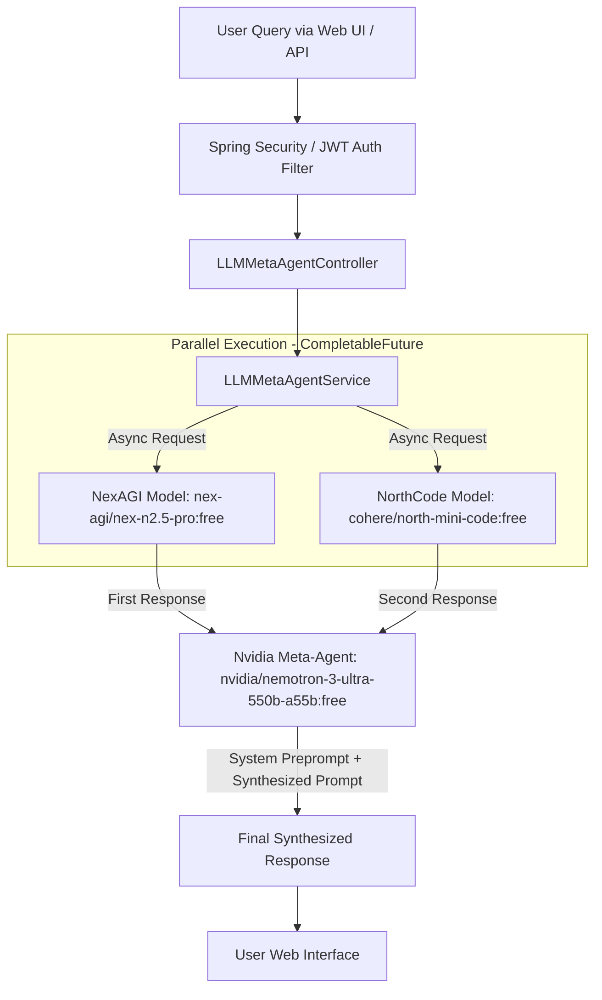

# 🧠 LLM Meta-Agent

An advanced AI system that combines the power of multiple language models to deliver superior, well-rounded, and synthesized responses. It uses a primary LLM (Nvidia Nemotron) as its central brain to autonomously synthesize insights from specialized underlying AI models (NexAGI and NorthCode).

    

---

## ✨ Key Features

- **🔄 Multi-Model Intelligence & Synthesis**: Concurrently queries **NexAGI** and **NorthCode** models and synthesizes their outputs using **Nvidia Nemotron** into a single, cohesive answer.
- **⚡ Asynchronous Concurrent Execution**: Utilizes `CompletableFuture` to fetch initial model responses in parallel, drastically reducing overall latency.
- **🔐 JWT Stateless Authentication**: Secure login flow using JWT stored in `HttpOnly` cookies, integrated with Spring Security.
- **🧠 Short Memory / Chat Advisor**: Retains conversational context across interactions per authenticated session using Spring AI `ChatMemory`.
- **📊 Real-time Model Insights**: Transparently inspect individual sub-model responses (`/api/nvidia/firstmodelresponse` & `/api/nvidia/secondmodelresponse`).
- **📝 Preprompt Externalization**: Externalized prompt template (`classpath:Preprompt`) to maintain prompt clarity and facilitate easy tuning.

---

## 🌐 Live Demo

Experience the application live: **[https://llm-meta-agent.onrender.com/](https://llm-meta-agent.onrender.com/)**  
*(Note: Initial load may take a minute on the free tier)*

---

## 🏗️ System Architecture



### Architecture Highlights
1. **Parallel Execution**: Both sub-agent calls run asynchronously using `CompletableFuture.supplyAsync()`.
2. **Context Window Memory**: NorthCode model leverages `MessageWindowChatMemory` scoped per authenticated user session.
3. **Synthesis Engine**: Nvidia Nemotron prompt combines the user query and both model outputs with externalized `Preprompt` rules.

---

## 🚀 Getting Started

### Prerequisites

- **Java 21** or higher
- **Maven** (or use the included `mvnw` wrapper)
- **OpenRouter API Key** (Provides access to NexAGI, NorthCode, and Nvidia models)

### Installation & Setup

1. **Clone the repository**
   ```bash
   git clone https://github.com/gaurabhkr/LLM-Meta-Agent.git
   cd LLM-Meta-Agent
   ```

2. **Configure API Keys**

   Set your OpenRouter API key as an environment variable or inside `application.properties`:
   ```bash
   export SPRING_AI_OPENAI_API_KEY=your_openrouter_api_key_here
   export SPRING_AI_OPENAI_BASE_URL=https://openrouter.ai/api/v1
   ```

3. **Build & Run the Application**
   
   On Linux/macOS:
   ```bash
   ./mvnw spring-boot:run
   ```
   
   On Windows:
   ```cmd
   mvnw.cmd spring-boot:run
   ```

4. **Access the Application**
   - **Login Page**: `http://localhost:8080/login.html`
   - **Default Credentials**:
     - Username: `user` | Password: `user`
     - Username: `admin` | Password: `admin`

---

## 🛠️ Technology Stack

| Category | Core Technologies |
| :--- | :--- |
| **Backend & Core** | `Java 21` • `Spring Boot 3.5.9` • `Spring AI 1.1.2` • `Maven` |
| **Security & Auth** | `Spring Security` • `JJWT 0.12.6` • `HttpOnly Cookies` |
| **AI Models (OpenRouter)** | `NexAGI (nex-agi/nex-n2.5-pro)` • `NorthCode (cohere/north-mini-code)` • `Nvidia Meta-Agent (nvidia/nemotron-3-ultra-550b)` |

---

## 🔌 API Endpoints

### 🔑 Authentication Endpoints

| Method | Endpoint | Description | Public / Auth |
| :--- | :--- | :--- | :--- |
| `POST` | `/api/login` | Authenticate user, generate JWT, and set `HttpOnly` cookie | Public |
| `GET` | `/api/logout` | Clear JWT cookie and redirect to login page | Public |

### 🤖 AI Agent Endpoints

| Method | Endpoint | Description | Public / Auth |
| :--- | :--- | :--- | :--- |
| `GET` | `/api/nvidia/{message}` | Main Meta-Agent query (Synthesizes responses concurrently) | Authenticated |
| `GET` | `/api/nexagi/{message}` | Query NexAGI model directly | Authenticated |
| `GET` | `/api/northcode/{message}` | Query NorthCode model directly (with memory support) | Authenticated |
| `GET` | `/api/nvidia/firstmodelresponse` | Retrieve NexAGI response from the latest Meta-Agent query | Authenticated |
| `GET` | `/api/nvidia/secondmodelresponse` | Retrieve NorthCode response from the latest Meta-Agent query | Authenticated |

---

## 🌟 Key Updates & Improvements

- **⚡ Service Architecture & Clean Code**: Decoupled business and AI logic from controllers into `@Service` classes.
- **🔐 JWT Authentication Flow**: Stateless security using `JwtAuthenticationFilter`, `LLMMetaAgentJwtService`, and `HttpOnly` cookies.
- **⚡ Latency Reduction**: Asynchronous sub-model fetching using `CompletableFuture.allOf()`.
- **🔄 Model Updates**: Upgraded AI configurations to active OpenRouter endpoints (`nex-agi`, `cohere/north-mini-code`, and `nvidia/nemotron-3-ultra-550b`).
- **📝 Externalized Prompts**: System preprompts loaded dynamically from `classpath:Preprompt`.
- **💬 Short-Term Memory**: Session-aware chat history management using `MessageWindowChatMemory`.

---

## 🤝 Contributing

Contributions are welcome! Please feel free to submit a Pull Request.

1. Fork the repository
2. Create your feature branch (`git checkout -b feature/AmazingFeature`)
3. Commit your changes (`git commit -m 'Add some AmazingFeature'`)
4. Push to the branch (`git push origin feature/AmazingFeature`)
5. Open a Pull Request

---

## 📝 License

This project is licensed under the MIT License - see the `LICENSE` file for details.

---

## 👤 Author

**Gaurabh** - [@gaurabhkr](https://github.com/gaurabhkr)

⭐ *If you find this project useful, please consider giving it a star!*


